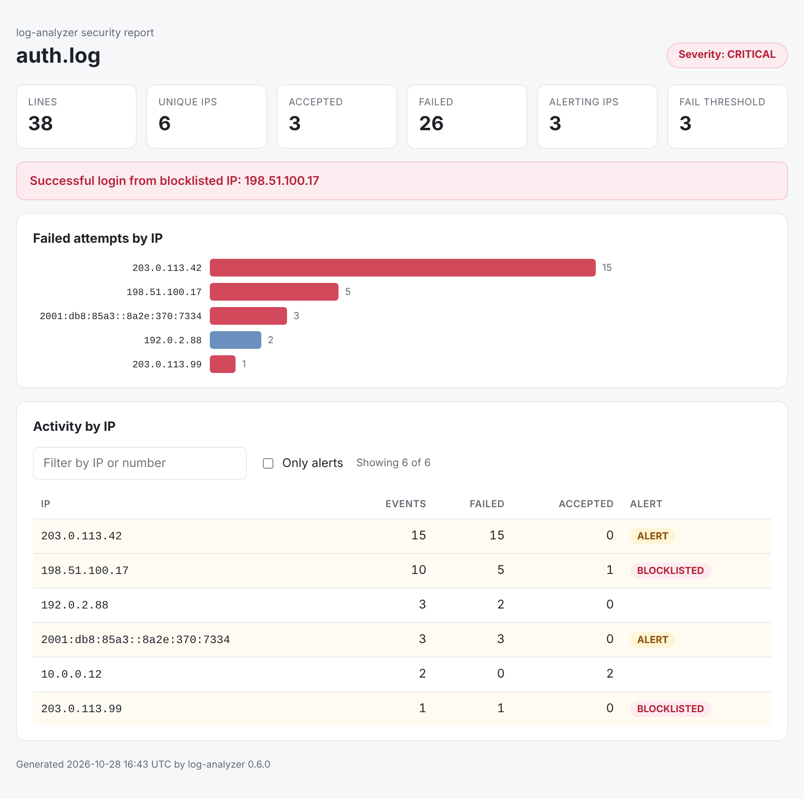

# log-analyzer

[](https://github.com/iMovingTarget/log_analyzer/actions/workflows/ci.yml)

[](LICENSE)

A command-line tool that reads SSH auth logs and nginx/Apache access logs, finds brute-force
activity per source IP, and reports it as a console summary, JSON, CSV, a self-contained HTML
page, and a JSONL event stream that a SIEM can ingest. It can also follow a live log and alert
on bursts as they happen. No dependencies outside the standard library unless you want GeoIP or
MySQL.



## What it finds

- **Brute force**: an IP whose failed attempts reach `--fail-threshold` raises a WARNING; three
  times the threshold raises CRITICAL.
- **Brute force that worked**: a successful login from an IP that had already failed a
  threshold's worth of times is marked CRITICAL in the SIEM stream.
- **Known-bad IPs**: anything from an address on your `--blocklist` is always reported, however
  little traffic it sent. A successful login from one makes the whole run CRITICAL.
- **Bursts, live**: `--watch` keeps following the file, across log rotation, and prints an alert
  when one IP fails `--rate-limit` times within `--rate-window` seconds.

## Quick start

```bash
git clone https://github.com/iMovingTarget/log_analyzer.git
cd log_analyzer
pip install .

log-analyzer --file examples/auth.log --blocklist examples/blocklist.txt
```

```text
Log format: ssh (auto-detected)

log-analyzer report: auth.log
Severity: CRITICAL
Lines: 38 | Accepted: 3 | Failed: 26

Top 5 IPs by events:
  203.0.113.42                      15
  198.51.100.17                     10
  ...

ALERTS (failed >= 3):
  203.0.113.42                  failed=15
  198.51.100.17                 failed=5
  2001:db8:85a3::8a2e:370:7334  failed=3

BLOCKLISTED IPs seen:
  198.51.100.17                 events=10
  203.0.113.99                  events=1
!! Successful login from blocklisted IP 198.51.100.17
Wrote CSV  -> reports/auth.csv
Wrote JSON -> reports/auth.json
Wrote HTML -> reports/auth.html
Saved to sqlite DB (run #1)
```

The example logs only use private addresses and the ranges reserved for documentation
(RFC 5737, RFC 3849), so they point at no real hosts.

## Usage

```bash
# A server's SSH log, with a lower bar for alerts
log-analyzer --file /var/log/auth.log --fail-threshold 5

# A web server log; the format is detected, or set it with --log-format access
log-analyzer --file /var/log/nginx/access.log

# Stream events to a SIEM-friendly JSONL file as well
log-analyzer --file auth.log --siem-out events.jsonl

# Ignore your own office, always flag known-bad addresses
log-analyzer --file auth.log --allowlist trusted.txt --blocklist known_bad.txt

# Report, then keep following the file and alert on bursts
log-analyzer --file /var/log/auth.log --watch --rate-limit 10 --rate-window 60
```

`log-analyzer --help` lists every option. Allowlists and blocklists are plain text files with one
IP per line; `#` starts a comment.

## Supported formats

| Log | `--log-format` | Counted as failed | Counted as accepted |
| --- | --- | --- | --- |
| OpenSSH (`sshd`) via syslog or journald | `ssh` | each `Failed <method>` line; a connection that ends before login after naming a user, if it logged no `Failed` line | `Accepted <method>` |
| nginx and Apache, common or combined format | `access` (aliases `nginx`, `apache`) | 4xx and 5xx responses | everything else |

For SSH, one attempt counts once even though sshd may log it on several lines (`Invalid user`,
`Failed password for invalid user`, `Connection closed by invalid user ... [preauth]`), and on a
server that only accepts keys, where the pre-auth disconnect is often the only trace, it still
counts. The client address is read from sshd's own `from <ip> port <n>` text, never from the
username, which the client chooses.

With the default `--log-format auto`, every parser scores how many of the first 200 non-blank
lines it recognises and the best score wins, so a stray keyword cannot switch the format.
Timestamps are read in classic syslog form (`Oct 26 03:12:10`), RFC 3339 form
(`2026-10-26T03:12:10+00:00`), and access-log form (`26/Oct/2026:09:00:01 +0000`).

## Output

| Output | Contents |
| --- | --- |
| Console | Summary, top IPs, threshold alerts, blocklist findings |
| `reports/<name>.json` | The full report: totals, top IPs, alerts, blocklist findings, severity |
| `reports/<name>.csv` | One row per IP: `ip, total, failed, accepted, alert, blocklisted` |
| `reports/<name>.html` | Self-contained page (no external files) with a chart and a sortable, filterable table |
| `--siem-out FILE` | JSONL, one event per parsed line (see below) |
| `reports.db` | Run history in SQLite (`--no-db` to skip), or MySQL/MariaDB with `--db-type mysql` |

Each SIEM event carries its own time from the log (in UTC), and a severity that reflects what
that IP had done up to that point, the way a streaming rule would see it:

```json
{
  "timestamp": "2026-10-26T03:14:29+00:00",
  "ingested_at": "2026-10-27T18:56:22.502763+00:00",
  "source_ip": "198.51.100.17",
  "event_type": "accepted",
  "severity": "CRITICAL",
  "reason": "successful login after 5 failures; successful login from blocklisted IP",
  "log_file": "examples/auth.log",
  "raw_log": "Oct 26 03:14:29 web-01 sshd[41052]: Accepted password for deploy from 198.51.100.17 port 44107 ssh2"
}
```

For MySQL, put the password in `LOG_ANALYZER_DB_PASSWORD` rather than on the command line,
where it would show up in the process list and shell history.

## Optional: country lookup

```bash
pip install ".[geoip]"
log-analyzer --file auth.log --geoip-db GeoLite2-Country.mmdb
```

The GeoLite2 database is not included. Download `GeoLite2-Country.mmdb` from
[MaxMind](https://dev.maxmind.com/geoip/geolite2-free-geolocation-data) with a free account; its
use is governed by MaxMind's GeoLite license.

## How it works

```text
src/log_analyzer/
  parsers.py   One parser per log format behind a common interface, plus format detection
  core.py      Per-IP aggregation, threshold alerts, severity, sliding-window rate tracker
  siem.py      Per-event JSONL output with escalating severity
  io.py        Reading logs, console / CSV / JSON / HTML output, GeoIP lookup
  watch.py     Follows a growing file across rotation and truncation
  storage.py   SQLite and MySQL run history
  __main__.py  Command-line interface
```

A few decisions worth knowing:

- **Undecodable bytes are replaced, not fatal.** Scanners send raw bytes as usernames, so real
  auth logs contain invalid UTF-8.
- **Watch mode reopens the file on every poll** instead of holding it open, so logrotate can
  rename or delete it, including on Windows. It notices rotation by the file's identity
  (`st_dev`, `st_ino`) and truncation by its size.
- **The rate tracker's memory is bounded** by the IPs active in one window: stale IPs are swept
  out at most once per window.
- **Blocklisted IPs are not rewritten.** Their events are classified like any other IP's, so a
  successful login from one stays visible as exactly that.

## Limitations

- Classic syslog timestamps carry no year or time zone: the year is inferred and the local zone
  of the machine running the analysis is assumed.
- SSH connections are told apart by client address and port. Log excerpts that start
  mid-connection, or rsyslog's `message repeated N times` lines (counted once), can make the
  count differ slightly from the true number of attempts.
- On `Failed publickey` lines for client certificates, sshd logs the certificate's key ID, which
  the client chooses, after the address; a crafted key ID could still mislead address extraction
  on those lines. Usernames cannot.
- For access logs, any 4xx or 5xx counts as a failure, so path scanning (404s) is treated like
  failed logins.
- The whole file is read into memory: fine for daily logs, not for multi-gigabyte archives.
- Watch mode polls, and can miss lines written in the moment between its last poll and a
  rotation.

## Development

```bash
pip install -e ".[dev]"
pytest
ruff check .
ruff format .
```

CI runs the tests on Python 3.10 to 3.14 on Linux and on Python 3.14 on Windows, runs Ruff, and
smoke-tests the installed command. See [CHANGELOG.md](CHANGELOG.md) for release notes.

## License

[MIT](LICENSE)
